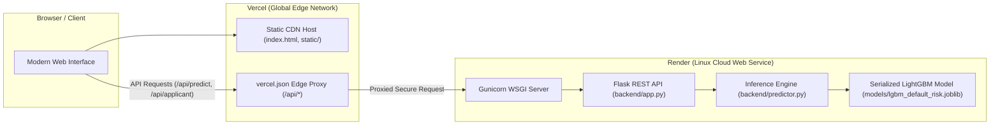

<div align="center">

# 🛡️ Home Credit Default Risk

### Intelligent Credit Scoring & Loan Risk Underwriting Engine
**GCI Global 2025 Machine Learning Competition** &bull; **Kaggle Home Credit Risk Challenge**

[](https://home-risk-prediction.vercel.app/)
[](https://home-risk-prediction.onrender.com/api/health)
[](https://www.python.org/)
[](https://lightgbm.readthedocs.io/)
[](LICENSE)

<br/>

**[Explore Live Web App](https://home-risk-prediction.vercel.app/)** &bull; **[API Health](https://home-risk-prediction.onrender.com/api/health)** &bull; **[Model Notebooks](advanced_techniques/)**

</div>

---

## 📌 Executive Summary

This repository contains the end-to-end data science pipeline, trained machine learning models, and a modern production web application for the **GCI Global 2025 Home Credit Default Risk Competition** (based on Kaggle's renowned dataset).

The goal is to accurately predict whether an applicant will face payment difficulties on their loan (binary classification: `TARGET = 1` for default, `0` for repaid). The production application enables credit underwriters and risk analysts to test what-if scenarios, assess individual applicant risk in real-time, and cross-reference predictions with competition submission benchmarks.

### 🏆 Key Highlights
- **Engineered LightGBM Classifier**: Trained on **171,202** loan applications achieving a **Validation ROC-AUC of 0.75545**.
- **Real-Time Underwriting Interface**: Predicts default probability in **< 250ms** with debt-to-income (DTI), credit terms, and factor impact breakdowns.
- **Applicant Dossier Search**: Instant lookup across **61,500 test applicants** with cross-model comparison across competition submissions.
- **Hybrid Cloud Deployment**: Global Edge Frontend on **Vercel** with automatic API rewrites to a Python WSGI container on **Render**.

---

## 🌐 Live System Architecture



---

## ✨ Features Walkthrough

### 1. 🎯 Interactive Risk Calculator & Underwriting
- **Financial Parameters**: Annual Income, Loan Credit Amount, Annuity, Goods Price, and Contract Type (Cash vs. Revolving).
- **Borrower Demographics**: Age, Employment Tenure, Education Level, Housing Situation, and Family Status.
- **External Bureau Ratings**: Interactive sliders for external credit bureau ratings (`EXT_SOURCE_1`, `EXT_SOURCE_2`, `EXT_SOURCE_3`).
- **Dynamic Decision Guideline**:
  - `Low Risk (< 8%)`: Approved (Prime/Standard rates)
  - `Moderate Risk (8% - 15%)`: Approved (Standard terms)
  - `Elevated Risk (15% - 25%)`: Conditional / Secondary document review
  - `High Risk (> 25%)`: Declined
- **Decision Factor Analysis**: Automated breakdown of positive credit drivers (e.g. stable employment, strong bureau rating) vs. risk triggers (e.g. high DTI, young age, multiple recent inquiries).

### 2. 🔍 Test Applicant Lookup
- Search any `SK_ID_CURR` from the 61,500 unseen applicants in `input/test.csv` (e.g. `#171202`, `#171203`, `#171204`).
- Automatically populates the borrower profile.
- Displays a cross-model prediction matrix comparing the active model against competition outputs (`submissionFinal.csv`, `submission.csv`, `Submission(1).csv`).

### 3. 📈 Competition Submissions & Outputs
- Summarizes all generated submission CSV files in `output/` with applicant counts, mean default rates, median probabilities, and direct download links.

---

## 📊 Model Progression & Benchmarks

Models developed and evaluated across the competition notebooks on the validation split:

| Model Architecture | Validation ROC-AUC | Description / Strategy |
| :--- | :---: | :--- |
| **Logistic Regression** | `0.6214` | Baseline linear model with StandardScaler |
| **Random Forest (max_depth=10)** | `0.7108` | Tree ensemble baseline from `tutorial.ipynb` |
| **AdaBoost Classifier** | `0.7325` | Boosting pipeline with imputed numericals |
| **XGBoost Classifier** | `0.7482` | Gradient boosted trees with native sparsity handling |
| **LightGBM (Active App Model)** | **`0.7554`** | Tuned LightGBM classifier with engineered ratios |
| **CatBoost (Optuna-Tuned)** | `0.7530` | 15-trial Bayesian hyperparameter search |
| **Blended Weighted Ensemble** | **`0.7562`** | Weighted blend: 0.60 XGB + 0.30 CatBoost + 0.10 LGBM |

---

## 🧠 Feature Engineering Pipeline

Key domain features engineered from raw credit application attributes:

1. **`LOG_AMT_INCOME_TOTAL`**: Log-transformed income $\ln(1 + \text{Income})$ to normalize severe right-skew.
2. **`EXT_MEAN`**: Row-wise composite mean across available external credit scores (`EXT_SOURCE_1`, `EXT_SOURCE_2`, `EXT_SOURCE_3`).
3. **`ANNUITY_INCOME_RATIO`**: Debt-to-Income (DTI) ratio:
   $$\text{DTI} = \frac{\text{AMT\_ANNUITY}}{\text{AMT\_INCOME\_TOTAL}}$$
4. **`CREDIT_TERM`**: Estimated repayment term in payments/months:
   $$\text{Term} = \frac{\text{AMT\_CREDIT}}{\text{AMT\_ANNUITY}}$$
5. **`CREDIT_INCOME_RATIO`**: Loan-to-income multiplier:
   $$\text{LTI} = \frac{\text{AMT\_CREDIT}}{\text{AMT\_INCOME\_TOTAL}}$$
6. **`GOODS_CREDIT_RATIO`**: Ratio of goods price to credit issued.
7. **`AGE_YEARS` & `EMPLOYED_YEARS`**: Converted from negative day counts (`DAYS_BIRTH`, `DAYS_EMPLOYED`).
8. **Outlier Filtering**: Capped anomalous car ages (`>= 60` years) and child counts (`>= 6`).

---

## 📁 Repository Structure

```
.
├── backend/                        # Flask REST API backend
│   ├── app.py                      # Application routing & endpoints
│   ├── predictor.py                # Feature engineering & LightGBM inference
│   ├── data_service.py             # Test data queries & submission parsers
│   └── train_model.py              # Model training & serialization script
├── frontend/                       # Source UI assets
│   ├── templates/index.html        # Clean HTML5 dashboard
│   └── static/                     # CSS styles & client JS
├── models/                         # Serialized models & metadata
│   ├── lgbm_default_risk.joblib    # Trained production LightGBM model
│   ├── model_metadata.json         # Feature names & categorical encodings
│   └── eda_cache.json              # Cached EDA dataset statistics
├── input/                          # Datasets
│   ├── test.csv                    # 61,500 test applicants (33 features)
│   ├── train.csv                   # 171,202 training applicants
│   └── sample_submission.csv       # Sample submission format
├── output/                         # Competition submissions
│   ├── submissionFinal.csv         # Final submission file
│   ├── submission.csv              # Tutorial submission
│   └── Submission(1).csv           # Iteration submission
├── index.html                      # Root entrypoint for Vercel deployment
├── static/                         # Root static files for Vercel
├── wsgi.py                         # Production WSGI entrypoint for Gunicorn
├── Procfile                        # Render / PaaS deployment directive
├── render.yaml                     # Render Blueprint specification
├── vercel.json                     # Vercel proxy configuration
├── requirements.txt                # Production Python dependencies
├── run_frontend.py                 # Local launcher script
├── run_frontend.bat                # Windows one-click launcher
└── README.md                       # Project documentation
```

---

## 🛠️ Local Development & Setup

### Prerequisites
- Python 3.10+ (Recommended: Python 3.11)
- Git

### Installation

1. **Clone the repository**:
   ```bash
   git clone https://github.com/Nileshkrishesh/Home-Risk-Prediction.git
   cd Home-Risk-Prediction
   ```

2. **Create and activate a virtual environment**:
   ```bash
   # Windows
   python -m venv venv
   .\venv\Scripts\activate

   # macOS / Linux
   python3 -m venv venv
   source venv/bin/activate
   ```

3. **Install dependencies**:
   ```bash
   pip install -r requirements.txt
   ```

4. **Launch the Web Application**:
   ```bash
   python run_frontend.py
   ```
   > On Windows, you can also double-click **`run_frontend.bat`**.

5. Open your browser at **`http://localhost:5000`**.

---

## 🔌 REST API Documentation

| Endpoint | Method | Description |
| :--- | :---: | :--- |
| **`/api/health`** | `GET` | Service status, model type, and validation ROC-AUC |
| **`/api/predict`** | `POST` | Calculate risk probability, tier, and factors for input borrower JSON |
| **`/api/applicant/<id>`** | `GET` | Lookup test applicant by `SK_ID_CURR` with multi-model predictions |
| **`/api/submissions`** | `GET` | Statistical summaries and distributions of output submission files |
| **`/api/metadata`** | `GET` | Model features list, benchmark comparisons, and sample presets |
| **`/api/columns`** | `GET` | Data dictionary descriptions for all 34 features |
| **`/api/download-submission`**| `GET` | Download submission CSV file by name (`?name=submissionFinal.csv`) |

### Example Prediction Request:
```bash
curl -X POST https://home-risk-prediction.vercel.app/api/predict \
  -H "Content-Type: application/json" \
  -d '{
    "AMT_INCOME_TOTAL": 200000,
    "AMT_CREDIT": 600000,
    "AMT_ANNUITY": 28000,
    "NAME_CONTRACT_TYPE": "Cash loans",
    "calc_age_years": 45,
    "calc_employed_years": 8,
    "NAME_EDUCATION_TYPE": "Higher education",
    "EXT_SOURCE_2": 0.65
  }'
```

### Example Response:
```json
{
  "probability": 0.0709,
  "probability_percent": 7.09,
  "risk_tier": "Low Risk",
  "recommendation": "Approved (Standard/Prime)",
  "financial_summary": {
    "annuity_income_ratio_pct": 14.0,
    "credit_income_ratio": 3.0,
    "credit_term_months": 21.4,
    "external_rating_mean": 0.65
  },
  "factors": {
    "strengths": [
      {
        "factor": "External Bureau Rating",
        "impact": "Score is above average borrower benchmark (0.50)",
        "value": "0.650"
      }
    ],
    "risk_drivers": []
  }
}
```

---

## ☁️ Deployment Instructions

### Deploy to Render (Backend)
1. Fork or push this repository to GitHub.
2. Sign in to [Render](https://render.com) and create a **New Web Service**.
3. Select your repository.
4. Settings:
   - **Runtime**: `Python 3`
   - **Build Command**: `pip install -r requirements.txt`
   - **Start Command**: `gunicorn wsgi:app`
   - **Environment Variable**: `PYTHON_VERSION = 3.11.9`
5. Click **Create Web Service**.

### Deploy to Vercel (Frontend)
1. Sign in to [Vercel](https://vercel.com) and click **Add New Project**.
2. Select your repository.
3. Keep default settings (`Other` framework, root directory `./`).
4. Click **Deploy**. Vercel will serve the frontend and proxy `/api/*` via `vercel.json`.

---

## 📜 License

This project is licensed under the [MIT License](LICENSE).

---

<div align="center">
  <sub>Developed for the <strong>GCI Global 2025 Competition</strong> &bull; Built with LightGBM, Flask, Vercel & Render</sub>
</div>
